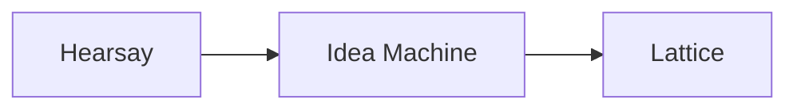

# junglestyle

AI systems built and run on my own hardware by [Nathan Curry](https://nathancurry.com), a software maintenance engineer in Red Hat's OpenShift Enhanced Solution Support team.

Everything here is built [Jungle Style](https://github.com/junglestyle/.github/blob/main/PRINCIPLES.md): use what's already racked. The [standards](https://github.com/junglestyle/.github/blob/main/code-standards/README.md) turn that into rules you can check in review.

The main project is a pipeline that turns recorded conversations into a map of the ideas in them:

| Project | What it is | Worth a look |
| --- | --- | --- |
| <picture><source media="(prefers-color-scheme: dark)" srcset="https://raw.githubusercontent.com/junglestyle/hearsay/main/docs/assets/hearsay-mark-dark.svg"></picture> [hearsay](https://github.com/junglestyle/hearsay) | Turns conversations recorded with consent into speaker-attributed transcripts. Pendant and Mac capture, self-hosted transcription and diarization. | Precision-first speaker attribution, everything rebuildable from raw, a versioned contract for consumers |
| <picture><source media="(prefers-color-scheme: dark)" srcset="https://raw.githubusercontent.com/junglestyle/ideamachine/main/docs/assets/ideamachine-mark-dark.svg"></picture> [ideamachine](https://github.com/junglestyle/ideamachine) | Segments transcripts into episodes and has Claude extract ideas, tasks and decisions with citations. | Triage models measured against hand labels before being trusted. They weren't, so the design changed. |
| <picture><source media="(prefers-color-scheme: dark)" srcset="https://raw.githubusercontent.com/junglestyle/lattice/main/docs/assets/lattice-mark-dark.svg"></picture> [lattice](https://github.com/junglestyle/lattice) | Local-first web app for reviewing captures and browsing the idea map by meaning. | Reads only Idea Machine's published views |
| <picture><source media="(prefers-color-scheme: dark)" srcset="https://raw.githubusercontent.com/junglestyle/hypertrace/main/docs/assets/hypertrace-mark-dark.svg"></picture> [hypertrace](https://github.com/junglestyle/hypertrace) | Research harness where an LLM proposes searches but code decides what counts as evidence. | Every quote verified against its source, adversarial review, per-call cost accounting |
| <picture><source media="(prefers-color-scheme: dark)" srcset="https://raw.githubusercontent.com/junglestyle/teem/main/docs/assets/teem-mark-dark.svg"></picture> [teem](https://github.com/junglestyle/teem) *(archived)* | Voice-to-pull-request coding agent with a button-press approval gate. | What it taught me is in its README |

Python, Postgres, SQLite, Claude, local models, Swift, Docker. [LinkedIn](https://www.linkedin.com/in/nathandcurry)

