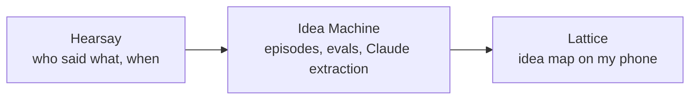

# junglestyle
 
AI systems built and run on my own hardware by [Nathan Curry](https://nathancurry.com), a software maintenance engineer in Red Hat's OpenShift Enhanced Solution Support team.
 
The main project is a pipeline that turns recorded conversations into a map of the ideas in them:
 

 
| Project | What it is | Worth a look |
| --- | --- | --- |
| [hearsay](https://github.com/junglestyle/hearsay) | Turns conversations recorded with consent into speaker-attributed transcripts. Pendant and Mac capture, self-hosted transcription and diarization. | Precision-first speaker attribution, everything rebuildable from raw, a versioned contract for consumers |
| [ideamachine](https://github.com/junglestyle/ideamachine) | Segments transcripts into episodes and has Claude extract ideas, tasks and decisions with citations. | Triage models measured against hand labels before being trusted. They weren't, so the design changed. |
| [lattice](https://github.com/junglestyle/lattice) | Local-first web app for reviewing captures and browsing the idea map by meaning. | Reads only Idea Machine's published views |
| [hypertrace](https://github.com/nathancurry/hypertrace) | Research harness where an LLM proposes searches but code decides what counts as evidence. | Every quote verified against its source, adversarial review, per-call cost accounting |
| [teem](https://github.com/junglestyle/teem) *(archived)* | Voice-to-pull-request coding agent with a button-press approval gate. | What it taught me is in its README |
 
Python, Postgres, SQLite, Claude, local models, Swift, Docker. [LinkedIn](https://www.linkedin.com/in/nathandcurry)
 

